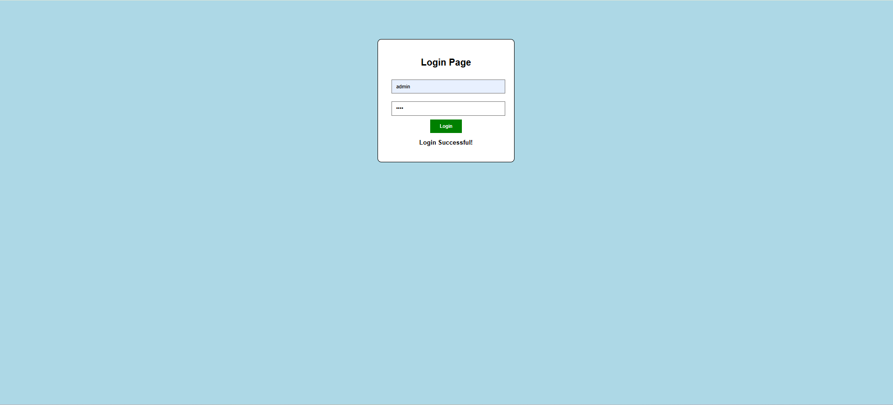

# MVC Login Page

A simple and user-friendly login page built using HTML, CSS, and JavaScript, demonstrating front-end web development fundamentals and login interface design.

## 📌 Project Overview

The MVC Login Page project focuses on creating a structured login interface with a clean layout and user-friendly design. It demonstrates how HTML, CSS, and JavaScript work together to build an interactive web page.

## ✨ Key Features

- 🔐 Simple login interface
- 🎨 Clean and organized user interface
- 🌐 Structured HTML layout
- 🖌️ CSS-based styling and visual presentation
- ⚡ JavaScript for client-side interactions
- 📱 Potential for responsive design enhancements

*Note: Include only the features that are actually implemented in your code.*

## 🛠️ Technology Stack

| Technology | Purpose |
|---|---|
| HTML5 | Structures the login page |
| CSS3 | Styles the page layout and elements |
| JavaScript | Handles client-side interactions |
| GitHub | Source code hosting and version control |

## 📂 Project Structure

```text
MVC-Login-Page/
├── index.html       # Main HTML page
├── style.css        # Styling and layout
├── script.js        # JavaScript functionality
├── Login-page.png   # Project image asset
└── README.md        # Project documentation
```

## 🖥️ Project Preview

The repository includes a project image. If `Login-page.png` is a screenshot of the finished login page, it can be displayed below.



## 🚀 Getting Started

### Prerequisites

- A modern web browser
- Visual Studio Code or another code editor (optional)

### Installation and Setup

1. Clone the repository:

   ```bash
   git clone https://github.com/JayantMM/MVC-Login-Page.git
   ```

2. Navigate to the project directory:

   ```bash
   cd MVC-Login-Page
   ```

3. Open `index.html` in your web browser.

No additional dependencies are required for a basic HTML, CSS, and JavaScript project.

## 🎯 Learning Outcomes

- Understanding HTML, CSS, and JavaScript integration.
- Practicing front-end interface design.
- Learning to organize project files.
- Understanding basic login page development.
- Improving front-end development skills.

## 🔮 Future Enhancements

- Improve responsive design for mobile and desktop screens.
- Add form validation and user-friendly error messages.
- Integrate a secure backend authentication system.
- Improve accessibility and keyboard navigation.

## 👨‍💻 Author

**Jayant Mohan Moger**

GitHub: [@JayantMM](https://github.com/JayantMM)

## 📄 License

Created for educational and learning purposes.
